<!--
  Generated by Readme Studio (https://readme.niessen.dev/).
  Edit readme.config.json instead of this file: the Readme Studio workflow rebuilds it.
  Open the design in the visual editor: https://readme.niessen.dev/#/studio?repo=mauricetopf/mauricetopf
  Agent guide: https://readme.niessen.dev/llms.txt
-->

<a href="https://github.com/mauricetopf"><picture><source media="(prefers-color-scheme: dark)" srcset="https://raw.githubusercontent.com/mauricetopf/mauricetopf/readme-studio/terminal-dark.svg"><source media="(prefers-color-scheme: light)" srcset="https://raw.githubusercontent.com/mauricetopf/mauricetopf/readme-studio/terminal-light.svg"></picture></a>

<picture><source media="(prefers-color-scheme: dark)" srcset="https://raw.githubusercontent.com/mauricetopf/mauricetopf/readme-studio/contrib-dark.svg"><source media="(prefers-color-scheme: light)" srcset="https://raw.githubusercontent.com/mauricetopf/mauricetopf/readme-studio/contrib-light.svg"></picture>

<a href="https://github.com/mauricetopf"><picture><source media="(prefers-color-scheme: dark)" srcset="https://raw.githubusercontent.com/mauricetopf/mauricetopf/readme-studio/board-dark.svg"><source media="(prefers-color-scheme: light)" srcset="https://raw.githubusercontent.com/mauricetopf/mauricetopf/readme-studio/board-light.svg"></picture></a>

